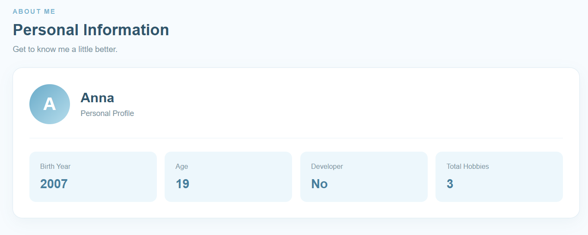
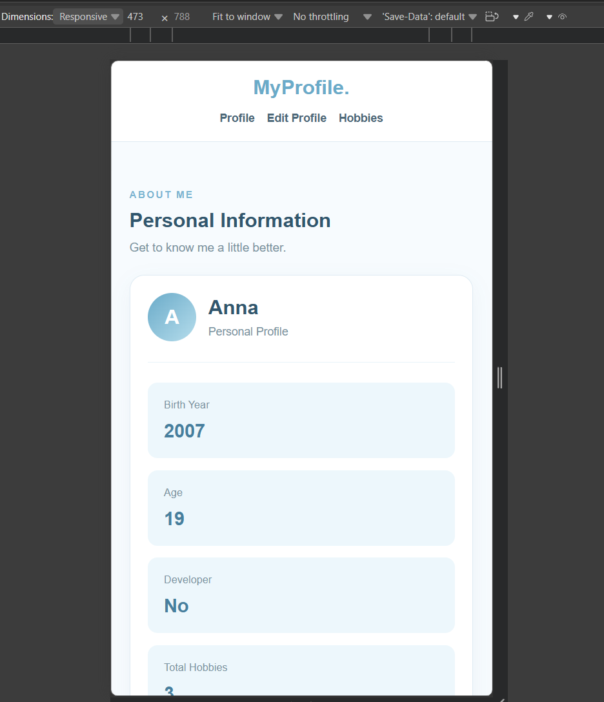
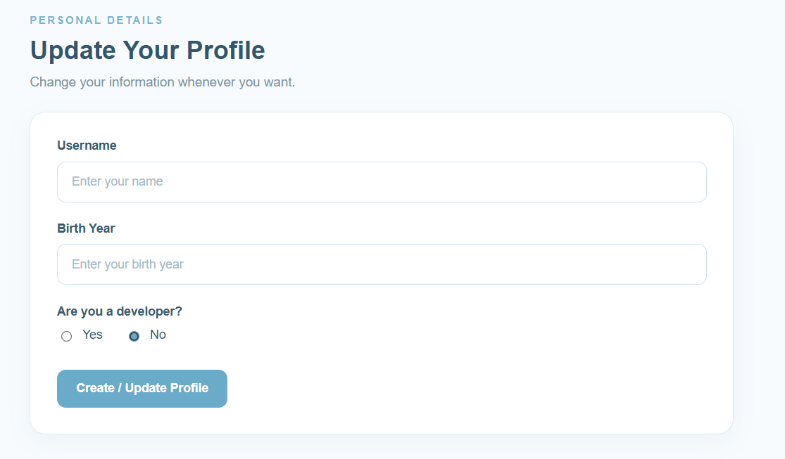
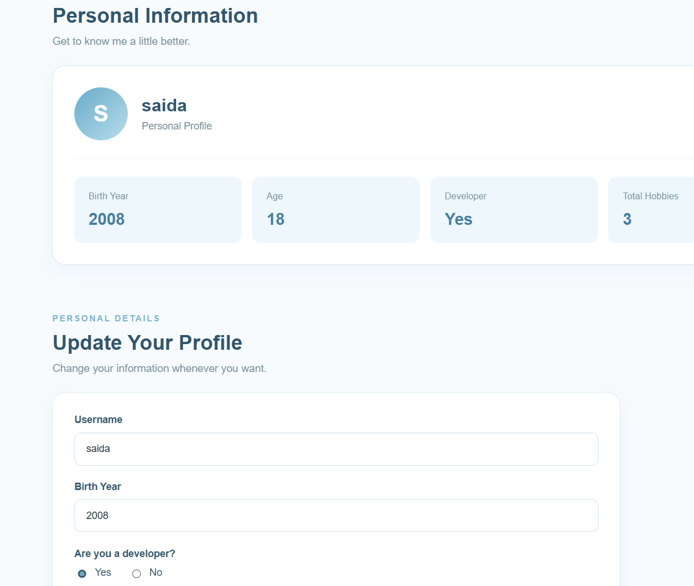
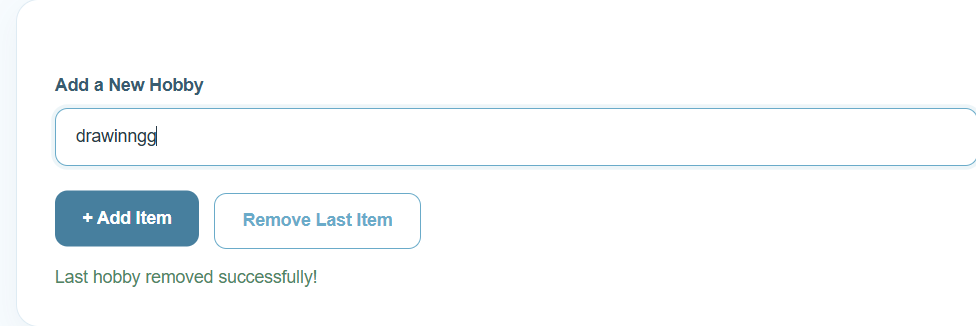
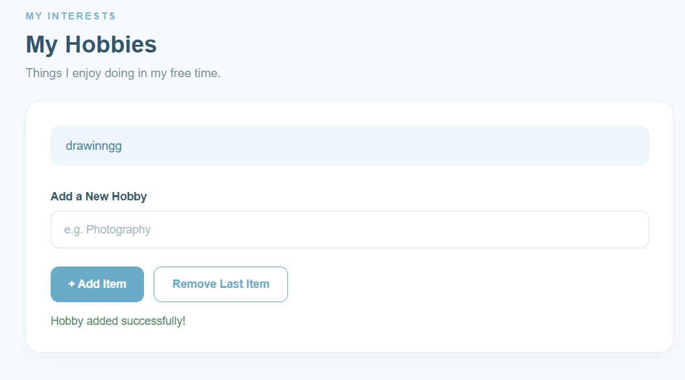

# Assignment #5 — JavaScript Basics (DOM Manipulation & Events)**

Amirgaliyeva Saida  
IT-2513

---

Project Description:
This project is a personal profile website created using HTML, CSS, and JavaScript. It demonstrates JavaScript basics, DOM manipulation, and event handling.
Users can view their profile information, update their name, birth year, and developer status, and add or remove hobbies dynamically.

Technologies Used:
- HTML5 — website structure
- CSS3 — styling and responsive design
- JavaScript — DOM manipulation, calculations, and event handling

---

Part 1: Profile Object, Data Types & Arithmetic

Task 1. The Personal Info Object
Created a JavaScript object named userProfile containing different data types:
- name — string
- birthYear — number
- isDeveloper — boolean
- hobbies — array
The profile information is displayed on the webpage using JavaScript.

Task 2. Arithmetic Calculations
Created the calculateAge() function to calculate the user's age dynamically using the current year and birth year.
Created the countHobbies() function to calculate the total number of hobbies.
Both values are displayed on the webpage and in the browser console.

---

Part 2: Form Input & Event Responses

Task 3. HTML Form Setup
Created an HTML form containing:
- Username input
- Birth Year input
- Developer status (Yes / No)
- Create / Update Profile button

Task 4. Event Listener
Added a submit event listener using addEventListener().
When the user submits the form, JavaScript reads the input values, updates the userProfile object, and displays the updated information on the page without reloading it.
The form also checks the entered name and birth year.

---

Part 3: DOM List Manipulation

Task 5. Creating & Removing Elements
Created an unordered list (ul) to display the user's hobbies.
Implemented two buttons:
Add Item — adds a new hobby to the array and creates a new li element using createElement() and appendChild().
Remove Last Item — removes the last hobby from the array and the webpage using pop() and remove().
The total hobbies count updates automatically.

---

Work Process Summary:
First, I created the HTML structure with three main sections: Personal Information, Update Profile, and My Hobbies.
Next, I styled the website using CSS, including Flexbox, Grid, and media queries for responsive design.
Then, I created the userProfile object in JavaScript and added functions to calculate age, count hobbies, and display profile information.
After that, I implemented form handling with addEventListener() to update the profile dynamically.
Finally, I added the functionality to create and remove hobbies using JavaScript DOM methods and tested the website.

Project Features:

Dynamic personal profile

Automatic age calculation

Total hobbies counter

Profile editing form

Developer status selection

Adding and removing hobbies

Responsive design